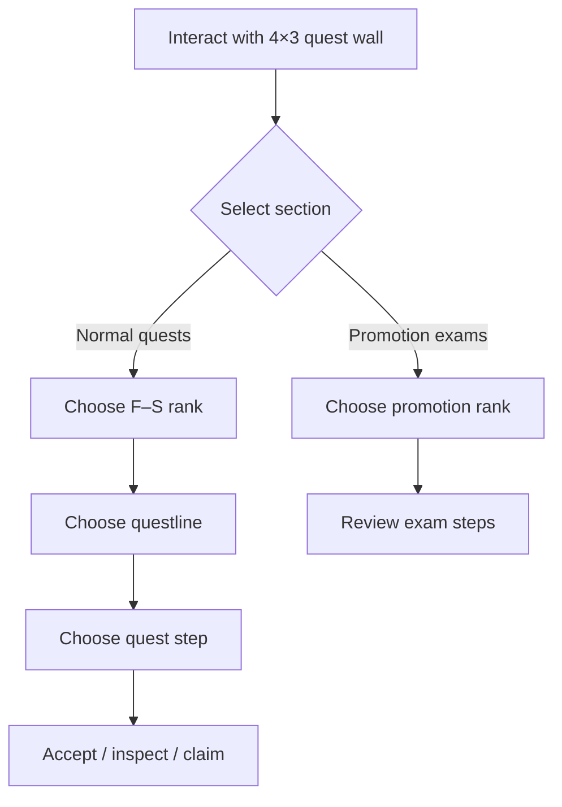

# Interactive quest sign walls

A quest wall provides an in-world alternative to opening the quest GUI. Recent LevelCraft design uses a **4 × 3 grid of signs** (twelve positions) to navigate guild tiers, questlines, quest steps and promotion exams.

## Intended player flow

## Player-specific pages

The wall was designed so **two players can browse independently** without continually rewriting the same physical sign text for everyone. That behaviour requires per-player presentation logic; ordinary shared sign updates would not provide independent pages.

## Configuration principles

- Bind each physical sign location to a logical wall position.
- Preserve the defined grid order so navigation buttons remain consistent.
- Guard against sign removal, invalid locations and unloaded chunks.
- Validate that the player is interacting with their own visible menu page.
- Re-render when progress, permissions or the active menu changes.

> **Command names**
>
> The exact wall-binding command syntax is not reproduced here because it is not confirmed in the available command manifest. Use the in-game admin editor or the matching build's help output rather than copying an invented setup command.

For quest definition examples, see [Quest YAML](https://github.com/MythicGhoul/LevelCraft/wiki/Reference-Quests-Config).

---

[🏠 Wiki Home](https://github.com/MythicGhoul/LevelCraft/wiki/Home) · [📚 Quests](https://github.com/MythicGhoul/LevelCraft/wiki/Quests) · [↗ GitHub repository](https://github.com/MythicGhoul/LevelCraft)
