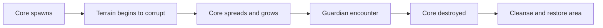

# Corruption outbreaks

A corruption core is an active world threat. As time passes it can spread across nearby chunks, change terrain, spawn a guardian and grow to a higher danger tier unless players intervene.

## Corruption levels

| Level | Name |
| ---: | --- |
| 1 | Tainted |
| 2 | Blighted |
| 3 | Infested |
| 4 | Void-Scarred |
| 5 | Nightfallen |
| 6 | Withered |
| 7 | Hollowed |
| 8 | Cursed |
| 9 | Eldritch |
| 10 | Abyssal |

## Life cycle

## World effects

Corrupted terrain can convert surfaces into thematic blocks such as mycelium, netherrack and soul sand. The system records transformed blocks so cleansing can restore the original terrain. Blindness and other atmospheric effects can apply near the core rather than throughout a whole region.

## Guardian mechanic

A powerful guardian, historically based on a Wither Skeleton, protects the core. In the documented design, players must defeat it before the core can be destroyed. Guardian difficulty is not necessarily the same as a normal mob's level.

## Growth settings

Admin settings include core spawning, level-up timing, active corruption limits, spread chance, spread boundaries, terrain changes, guardian properties and cleansing rewards. Key sections in a referenced `config.yml` include `Corruption.Core`, `Corruption.Spread` and related reward settings.

## Rewards

Rewards may contain special corrupted items, themed weapons and other equipment. The system also integrates with Discord alerts and web maps where configured.

## Protecting communities

A referenced design prevents cores from appearing within a large exclusion radius of clan bases and keeps them away from spawn. Admins should configure exclusions carefully to avoid destroying protected builds.

See [Maps](https://github.com/MythicGhoul/LevelCraft/wiki/World-Maps) for web overlays and [Events](https://github.com/MythicGhoul/LevelCraft/wiki/World-Events) for Hive-related world threats.

---

[🏠 Wiki Home](https://github.com/MythicGhoul/LevelCraft/wiki/Home) · [📚 World](https://github.com/MythicGhoul/LevelCraft/wiki/World-Systems) · [↗ GitHub repository](https://github.com/MythicGhoul/LevelCraft)
