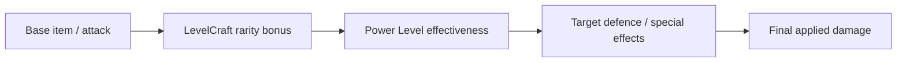

# Combat, health and damage

LevelCraft combines player progression, item quality, item requirements and enemy scaling. A damage result should be treated as a pipeline, not as a single static weapon number.

## Broad damage model

The model is conceptual; event cancellation, Minecraft armour and other plugins can modify final applied damage.

## Player health

Recent balancing goals use substantially more than vanilla twenty health points by high Combat levels while presenting a manageable heart display through health scaling. Actual caps and formulas should be measured in the live build and validated against Minecraft attribute limits.

## Unarmed combat

Unarmed damage can also scale with Combat level using configurable base damage, per-level gains and a capped result. It does not follow exactly the same logic as item rarity, because no equipment rarity or PL is present.

## Debugging unexpectedly low damage

Check the target entity's scaling, the weapon's PL, the player's Total Level, enchantments, PvP/PvE flags, projectile handling, damage-cancellation events and other combat plugins. See [Troubleshooting](../administration/troubleshooting.md).

---

[← Documentation contents](../README.md) · [Project homepage](../../README.md)
