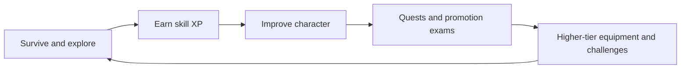

# LEVELCRAFT

THE COMPLETE RPG PROGRESSION FRAMEWORK

**Forge your path. Master your craft. Become legend.**

LevelCraft builds an RPG around the normal Minecraft survival loop. Mining, crafting, fishing, exploring, defeating mobs, protecting territory and completing quests all feed meaningful character progression. Rather than sending players into isolated menus, its systems connect to the same living world.

11 skills6 races6 pathsF → S guild ranksRarity & socketsMagic & world events

-   :material-rocket-launch-outline: **New to LevelCraft?**

    ---

    Install the plugin, understand your first login and configure onboarding.

    [Start here](getting-started/installation.md)

-   :material-account-star-outline: **Create your character**

    ---

    Choose a race and path, master eleven skills and earn your guild rank.

    [Character progression](progression/overview.md)

-   :material-sword-cross: **Gear & sorcery**

    ---

    Learn rarity, forging, gems, Power Level and the spellbook.

    [Equipment guide](equipment/overview.md)

-   :material-earth: **Explore the world**

    ---

    Fight corruption, track shrines, find encounters and defeat bosses.

    [World systems](world/overview.md)

-   :material-account-cog: **Server administration**

    ---

    Configure quests, NPCs, events, data backups and performance.

    [Admin setup](administration/overview.md)

-   :material-code-braces: **Commands & integrations**

    ---

    Find command syntax, permissions, placeholders and integration notes.

    [Reference library](reference/commands.md)

## The progression loop

LevelCraft is designed for survival servers that want longer-term goals while keeping vanilla activities relevant. Many modules are configurable or require an admin to place NPCs, arenas, shrines or other content.

!!! info "Documentation scope"
    This repository contains **documentation only**. It does not expose the private LevelCraft Java source, bundled custom assets, player data or server credentials. The current public [LevelCraft repository](https://github.com/MythicGhoul/LevelCraft) initially contains only its licence; use this documentation package to add the website files alongside it.

### Popular starting points

[Skill catalogue](progression/skills/index.md) · [Races](progression/races.md) · [Paths](progression/paths.md) · [Quests](quests/overview.md) · [Magic](magic/overview.md) · [Configuration](reference/configuration.md) · [Troubleshooting](administration/troubleshooting.md)
