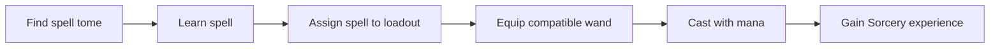

# Sorcery & spellcasting

Sorcery is a LevelCraft skill built around discovering spells, managing mana and using magical equipment. Spells may heal allies, damage opponents or alter the battlefield.

## Magic loop

## Mana

Mana has a maximum capacity, regeneration and per-spell costs. Earlier design targets raised base mana through Sorcery progression (roughly 30 → 200) and regeneration by skill level. Live values depend on `Mana-Settings` and magic code.

## Controls

- **Left-click** with the wand to cast the selected spell in referenced builds.
- **Right-click** can cycle through available spells or interact with a configured quick-use flow.
- The spellbook/loadout editor can assign a limited set of spells (six-slot design) for quick use.

Controls can conflict with item-use or protection plugins; always test in the current version.

Read [Spells](spells.md), [Wands](wands.md) and [Mana](mana.md).

---

[← Documentation contents](../README.md) · [Project homepage](../../README.md)
