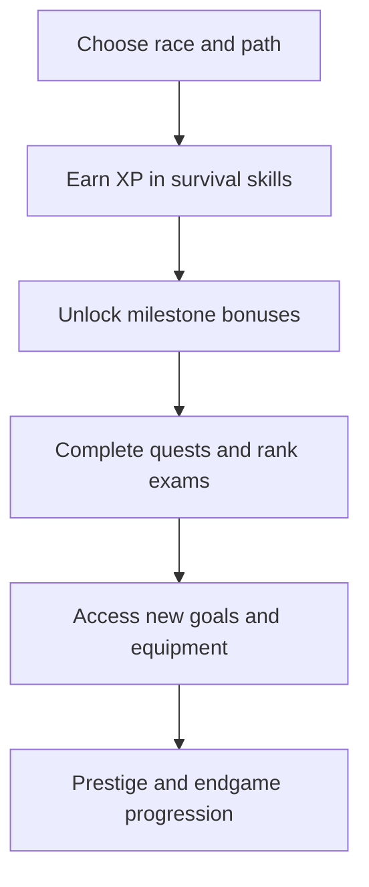

# Character progression

LevelCraft progression operates on several layers: eleven separate skills, an overall Total Level, milestone perks, races, paths, prestige and guild promotions. The purpose is to let players develop a recognisable identity through ordinary play.

| System | Question it answers |
| --- | --- |
| [Skills](skills/index.md) | What activities have I mastered? |
| [Total Level](leveling.md) | How far has this character progressed overall? |
| [Milestones](milestones.md) | Which bonuses has each skill unlocked? |
| [Race](races.md) | What strengths and trade-offs define my origin? |
| [Path](paths.md) | What role am I specialising in? |
| [Guild rank](guild-ranks.md) | What tier of adventurer have I earned? |
| [Prestige](prestige.md) | What long-term goals remain after mastery? |

## A typical progression journey

**Important distinction:** Guild rank is not identical to Total Level. A player can have a high Total Level while still needing to complete promotion requirements or exam encounters.
